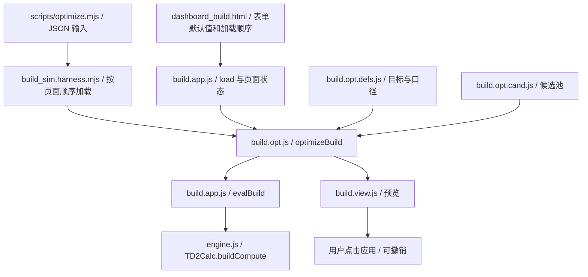

# 配装器代码导航

## 建议阅读顺序

1. `web/dashboard_build.html`：真实 DOM、表单默认值、样式与脚本加载顺序。当前使用 classic script 共享全局状态，不是可随意调换顺序的独立模块。
2. `web/assets/db/build.app.js`：`load()` 加载数据、建立索引、恢复配装并渲染；`evalBuild()` 是页面和搜索调用计算引擎的桥梁。
3. `web/assets/db/engine.js`：`TD2Calc.buildCompute()` 计算公式。先确认公式依据，再改这里。
4. `web/assets/db/build.opt.defs.js`、`build.opt.cand.js`、`build.opt.js`：依次看口径定义、候选生成、搜索调度。
5. `web/assets/db/build.view.js`、`build.picker.js`、`build.layout.js`：结果呈现、物品选择、页面布局。
6. `web/standalone.js`、`web/assets/db/build.account.js`、`build.share.js`：独立运行适配、本地保存与分享。独立适配器最后加载，覆盖账户请求实现。
7. `scripts/devcheck/build_sim.harness.mjs`、`build_sim.mjs`、`tests/optimizer*.test.mjs`：加载装置、页面计算模拟与优化器回归。

除另有完整路径外，上述 `build.*` 文件均位于 `web/assets/db/`。

## 搜索与评分



搜索是有预算的候选推荐，不保证全局最优。修改搜索策略时保留约束检查、唯一性、锁定格与预算；修改评分先检查 `evalBuild()` 到引擎的口径，别在优化器里另写一份伤害公式。

预览不等于应用。`build.view.js` 的 `optSnap()` 保存配装快照，应用和撤销要覆盖武器、装备、词条、插件及相关条件；回归时同时检查“生成预览未改手配”和“应用后可撤销”。

## 按需求找文件

- 属性、条件与天赋：`build.attrs.js`、`build.req.js`、`build.gtal.js`、`build.triggers.js`、`build.tiers.js`；数据映射与索引见 `build.data.js`。
- 武器／装备插件：`build.mods.js`；目标参数与敌人系数：`build.params.js`。
- 专长与按需加载：`build.specialization.js`；图表：`build.charts.js`；诊断：`build.audit.js`。
- 页面样式：`build.css`、`build.layout.css`、`build.pen.css`、`build.picker.css`、`build.card.css`、`build.share.css`。实际引入顺序以 HTML 为准。
- 本地保存：`web/standalone.js`，浏览器 localStorage；可选云存档处理器：`integrations/flarum/`，集成前读其 README。

## 改完怎么验证

```sh
npm run check
npm run simulate
npm run optimize
npm test
```

`check` 校验提取源文件的哈希、JSON 可解析性和 HTML 本地脚本／样式路径；它不代替浏览器交互验证。主动修改被清单追踪的源码会使哈希检查失败，这是相对提取快照的差异提示，需审查后有意更新清单，不能直接批量刷新哈希掩盖改动。

当前回归有既存失败，详情见根目录 `VALIDATION.md`。改页面还需实际检查 PC／手机、深浅主题、选择后应用、本地保存、预览／应用／撤销与分享；模拟器不覆盖完整浏览器行为。
